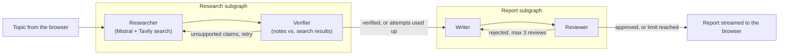

# Licht

**Illuminating Research. Delivering Intelligence.**

Licht turns any topic into a structured, source-backed report. You type a subject, and a multi-step AI pipeline searches the web, checks its own findings against the search results, writes a report, reviews it, and streams it to your browser, where you can read it or download it as a PDF.

> **Note:** Reports are generated by AI and may contain errors or outdated information. Always verify important facts using the sources listed at the end of each report.

---

## Features

- **Topic to report in one step.** Enter any subject and get a structured markdown report rendered in the page.
- **Live progress.** The page shows what the pipeline is doing right now (searching, verifying, writing, reviewing) while it works.
- **Web research with Tavily.** The researcher agent runs several searches and writes notes from the results only.
- **Fact verification.** A verifier compares the notes with the raw search results and sends the researcher back for another pass if claims are unsupported.
- **Write and review loop.** A writer drafts the report and a reviewer critiques it against the research. A rejected draft is revised, up to three reviews.
- **Sources included.** The report ends with the list of source URLs the research used.
- **PDF download.** One click exports the report as an A4 PDF named after the topic.
- **Safe rendering.** Report markdown is converted with `marked` and sanitized with `DOMPurify` before it is shown.
- **Responsive UI.** The landing screen animates into a compact header when a report is generated, and the layout adapts to phones.

---

## How it works



A top-level supervisor graph decides the next step: research first, then report generation, then finish. If any step fails, an error handler stops the run and the error is sent to the browser.

| Stage | What it does |
| --- | --- |
| **Researcher** | An LLM with the Tavily search tool gathers facts, then extracts a structured summary and a list of source URLs. |
| **Verifier** | Compares the summary with the raw search results. If a claim is unsupported, it sends feedback back to the researcher (at most `MAX_VERIFY_ATTEMPTS` attempts). |
| **Writer** | Writes the report in markdown from the research notes, or revises the previous draft using the reviewer's feedback. |
| **Reviewer** | Checks the report against the research and returns a structured decision (`good` or `bad`) with a reason and suggestions. |
| **Sources** | The list of source URLs is appended to the finished report. |

---

## Tech stack

**Backend**

- Python 3.12
- FastAPI and Uvicorn
- LangGraph and LangChain (`langchain-core`, `langchain-mistralai`, `langchain-tavily`)
- Mistral AI (`ministral-14b-2512`) as the language model
- Tavily as the web search tool
- `python-dotenv` for configuration, and optional LangSmith tracing

**Frontend**

- Plain HTML, CSS and JavaScript (no build step)
- [marked](https://marked.js.org/) for markdown, [DOMPurify](https://github.com/cure53/DOMPurify) for sanitizing
- [html2pdf.js](https://github.com/eKoopmans/html2pdf.js) for PDF export
- Montserrat from Google Fonts

---

## Project structure

```
ReportGen/
├── backend/
│   ├── main.py                 # FastAPI app, CORS, router registration
│   ├── requirements.txt        # Backend dependencies
│   ├── .env                    # API keys (not committed, create it yourself)
│   └── routers/
│       └── getReport.py        # LangGraph pipeline and the /getReport SSE endpoint
├── frontend/
│   ├── index.html              # Page structure
│   ├── style.css               # Styling, transitions and responsive rules
│   ├── test.js                 # Talks to the backend, renders the report, PDF export
│   ├── Logo.png                # Logo and favicon
│   └── Background.png          # Illustration behind the search bar
├── src/reportgen/              # Leftover uv project template (not used by the app)
├── pyproject.toml              # uv project metadata (not used by the app)
└── .python-version             # Python 3.12
```

---

## Getting started

### Prerequisites

- Python 3.12 or newer
- A [Mistral AI](https://console.mistral.ai/) API key
- A [Tavily](https://tavily.com/) API key

### 1. Backend

```powershell
cd backend

# create and activate a virtual environment
python -m venv .venv
.venv\Scripts\activate          # macOS/Linux: source .venv/bin/activate

# install dependencies
pip install -r requirements.txt
```

Create `backend/.env`:

```env
MISTRAL_API_KEY=your_mistral_key
TAVILY_API_KEY=your_tavily_key

# optional: LangSmith tracing
LANGSMITH_TRACING=true
LANGSMITH_API_KEY=your_langsmith_key
LANGSMITH_PROJECT=licht
```

Start the server:

```powershell
uvicorn main:app --reload
```

The API is now at `http://127.0.0.1:8000`, and the interactive docs are at `http://127.0.0.1:8000/docs`.

> **Windows tip:** if you get `WinError 10013` on port 8000, run `uvicorn main:app --reload --port 8001` and use port 8001 in the next step.

### 2. Frontend

Open `frontend/test.js` and point `API_BASE` at your local backend:

```javascript
const API_BASE = "http://127.0.0.1:8000";
```

Serve the folder and open it in your browser:

```powershell
cd frontend
python -m http.server 5500
```

Then visit `http://localhost:5500`. (The VS Code *Live Server* extension works too.)

---

## API

### `GET /getReport?topic=<text>`

Streams the progress and the result as [Server-Sent Events](https://developer.mozilla.org/en-US/docs/Web/API/Server-sent_events). Each event is one JSON object in a `data:` line:

```text
data: {"type": "status", "message": "Scraping the web for facts..."}

data: {"type": "status", "message": "Verifying the scraped facts..."}

data: {"type": "report", "report": "# Title\n\n## Section ..."}
```

| `type` | Fields | Meaning |
| --- | --- | --- |
| `status` | `message` | A progress update. Can appear many times. |
| `report` | `report` | The finished report in markdown. Final event on success. |
| `error` | `message` | Something failed. Final event on failure. |

Status messages you will see: *Scraping the web for facts...*, *Verifying the scraped facts...*, *Scraping the web for more facts...* (a retry), *Generating the report...*, *Reviewing the report and verifying the evidence...*, *Refining the report...*. The server also sends a `: keepalive` comment every 15 seconds so idle connections stay open.

---

## Configuration

These values live in `backend/routers/getReport.py`:

| Setting | Where | Default | Effect |
| --- | --- | --- | --- |
| Model | `ChatMistralAI(model=...)` | `ministral-14b-2512` | The model used by every step. |
| Search results per query | `TavilySearch(max_results=...)` | `5` | How many pages each search returns. |
| Verification attempts | `MAX_VERIFY_ATTEMPTS` | `2` | Verifier passes before the notes are accepted as they are. |
| Review rounds | `repstate["count"] < 3` in `decider` | `3` | Maximum write and review rounds. |
| Writer rules | `WRITER_RULES` | see file | Title format and what the writer must not include. |

Frontend branding lives in `frontend/index.html` (name, tagline, intro text) and `frontend/style.css` (colors, gradient title, layout).

---

## Deployment

The app is designed to run as two services: the backend on [Render](https://render.com) and the frontend on [Vercel](https://vercel.com).

### Backend on Render (Web Service)

| Setting | Value |
| --- | --- |
| Root Directory | `backend` |
| Build Command | `pip install -r requirements.txt` |
| Start Command | `uvicorn main:app --host 0.0.0.0 --port $PORT` |
| Environment variables | `MISTRAL_API_KEY`, `TAVILY_API_KEY` (and the optional `LANGSMITH_*` ones) |

The Start Command must bind to `0.0.0.0` and use `$PORT`, otherwise Render cannot detect the service. The free plan sleeps when idle, so the first request after a quiet period can take 30 to 60 seconds.

### Frontend on Vercel

| Setting | Value |
| --- | --- |
| Root Directory | `frontend` |
| Framework Preset | Other (static site) |
| Build Command | none |

Set `API_BASE` in `frontend/test.js` to your Render URL before deploying, for example `https://your-service.onrender.com`. Pushes to `main` deploy both services automatically.

---

## Troubleshooting

| Problem | Likely cause and fix |
| --- | --- |
| "Connection lost" right away | The backend is asleep or unreachable, `API_BASE` is wrong, or the browser blocked the request (check the console for a CORS error). |
| Backend returns an error about a key | `MISTRAL_API_KEY` or `TAVILY_API_KEY` is missing or wrong. Add it to `backend/.env` locally, or to the Render environment. |
| `WinError 10013` when starting Uvicorn | Port 8000 is in use or reserved. Start with `--port 8001`. |
| Render says "No open ports detected" | The Start Command is missing `--host 0.0.0.0 --port $PORT`. |
| PDF is blank or cut off on a phone | Long reports can exceed the phone browser's canvas limit. Try on a desktop browser. |

---

## Known limitations and roadmap

- **AI can be wrong.** Verification and review reduce errors but cannot remove them.
- **Slow on free hosting.** The pipeline makes several sequential model calls, and the free Render plan has little CPU and sleeps when idle.
- **No authentication or rate limiting yet.** Before sharing the app widely, restrict the allowed origins in `backend/main.py` and add request limits.
- **PDF export is image-based.** The text in the PDF is not selectable.

Ideas for next steps: a final quality check that rejects reports containing placeholders or invented references, faster parallel searching, request limits, and a history of past reports.

---

## Author

Built by **Hrishikesh Chamarthy** ([@Hrishi-2008](https://github.com/Hrishi-2008)).
